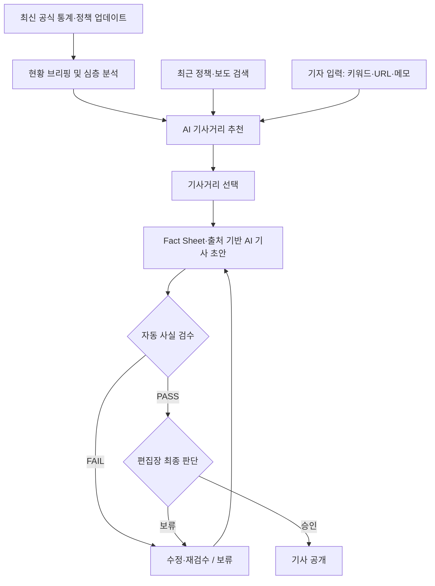
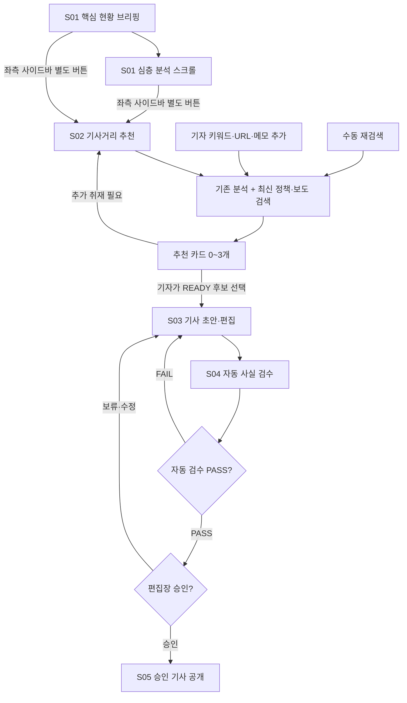
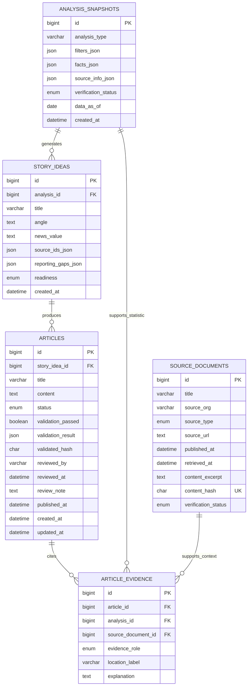

# 노인보행자 교통사고 데이터 뉴스룸

> **서울 고령 보행자 교통사고의 최신 공식 현황을 브리핑하고, 심층 분석과 최신 정책·보도 검색을 결합해 기사거리를 발굴하며, 근거 있는 기사를 검수·승인 후 공개하는 데이터 뉴스룸.**

- **구현 상태:** S01 분석 화면, S02 추천·MySQL 저장, S03 기사 초안 생성·수정·재조회, S04 검수 PASS·최종 승인까지 사용자 확인. S05 승인 기사 목록·상세 사용자 확인. 매일 RSS 검색·로컬 분석 CSV 변경 감지 구현(Windows 작업 스케줄러 사용자 설치·실행 검증 대기). 공식 통계 원천자료 자동 다운로드는 미구현
- **대상 범위:** 서울시 고령 보행자 교통사고 및 노인보호구역
- **기존 분석 기반:** [elder_accident](https://github.com/csy04x2/elder_accident)
- **참고 프로젝트:** [RGF](https://github.com/csy04x2/RGF) (기사거리·정보 공백 발굴), [RentWatch Seoul](https://github.com/csy04x2/rentwatch-news) (Fact Sheet 기반 기사 생성·검수·승인)

## 목차

1. [프로젝트 소개](#1-프로젝트-소개)
2. [기능정의서](#2-기능정의서)
3. [화면구성도](#3-화면구성도)
4. [DB 설계](#4-db-설계)
5. [데이터 수집 방법](#5-데이터-수집-방법)
6. [개발 환경](#6-개발-환경)
7. [실행 방법](#7-실행-방법)
8. [테스트 항목](#8-테스트-항목)

---

## 1. 프로젝트 소개

### 주제와 목표

**기본 서비스는 분석 대시보드다.** 첫 화면에 최신 공식 통계로 계산한 핵심 현황을 간결하게 브리핑하고, 아래로 스크롤하면 기존 심층 분석(보호 필요성 → 위험 지역 → 보호구역·사고다발지역 → 정책 검토)을 차례로 읽을 수 있다. 좌측 사이드바는 본문 스크롤에 따라 현재 섹션을 표시하고, 섹션을 클릭하면 해당 위치로 이동한다.

사이드바의 별도 **「AI 기사거리 추천」** 버튼은 기자용 작업 화면으로 이동한다. 여기서 기존 데이터 분석에 **최근 공식 정책·보도자료와 언론보도 검색 결과**를 결합해 기사거리 후보를 추천한다. 기자는 필요시 최신 자료를 다시 검색하거나 중요하다고 판단한 **키워드·원문 URL·취재 메모/자료 내용**을 직접 입력해 추천 방향을 조정한다. 기사거리를 선택하면 AI 초안을 생성하고 자동 사실 검수와 편집장 승인 절차를 거쳐 승인된 기사만 공개한다.

**실시간 교통사고 발생 감시/TOPIS는 범위에서 제외한다.** '최신'이란 공개 기관의 신규 통계·정책 발표를 확인해 반영한다는 뜻이며, 실시간 고령 보행자 사고 발생 건수라는 의미가 아니다. 통계 기준일과 마지막 수집·확인 시각을 분리해 표시한다.

### 대상 사용자·독자

| 사용자 | 주요 이용 목적 |
|---|---|
| 일반 독자 | 최신 현황 브리핑, 심층 분석, 승인 기사 열람 |
| 기자/분석 담당 | 분석 결과 확인, 기사거리 추천·재검색, 취재 단서 입력, 기사 초안 작성·수정 |
| 편집장 | 기사 근거 대조, 검수 결과 확인, 최종 승인·보류 |

### 화면 이미지 자리

> **화면 캡처는 구현 후 추가한다.** 현재 이미지를 실제 작동 화면으로 오인하지 않도록 빈 자리만 표기한다.

- [이미지 자리 ①] 뉴스룸 홈: 핵심 현황 브리핑 + 스크롤형 분석 + 고정 사이드바
- [이미지 자리 ②] AI 기사거리 추천: 추천 카드 + 최신 정책·보도 검색 + 기자 입력
- [이미지 자리 ③] 기사 초안 편집: 본문 + Fact Sheet·출처
- [이미지 자리 ④] 자동 검수·편집장 승인: 오류 목록 + 승인·보류

### 서비스 전체 흐름



### 범위 밖

정책자료 PDF 업로드를 필수로 하는 범용 RGF 플랫폼, 고령 보행자 외 주제 분석, TOPIS 등 실시간 도로 돌발정보, 개별 사고 실시간 집계, AI 단독 자동 발행, 자동 사실 검증의 무오류 보장은 구현 범위가 아니다. 기자의 URL·메모 입력은 **기사거리 검색을 돕는 취재 단서**이며 자동으로 검증된 사실이 되지 않는다.

---

## 2. 기능정의서

| ID | 기능명 | 설명 | 입력 → 출력 |
|---|---|---|---|
| F01 | 공식 데이터 갱신 확인 | TAAS·서울시 등 공식 출처의 신규 공표 확인. 지원 형식만 자동 반영하고 불가능한 자료는 수동 확인 대상으로 표시 | 출처·버전·공표일 → 변경 여부·수집 상태 |
| F02 | 현황 브리핑 | 최신 확보 통계의 핵심 사고·사망·사고율·고령 사망 비중·증감 요약. 기준연도 명시 | 검증된 패널 → 간결한 지표·요약 |
| F03 | 심층 분석 대시보드 | 기존 고령인구, 사고·사망 부담, 자치구 비교, 보호구역 공간 분석 재사용 | 가공 CSV·선택 지역/연도 → 차트·지도 |
| F04 | 스크롤·사이드바 동기화 | 본문 스크롤에 따라 활성 섹션 강조, 사이드바 클릭으로 앵커 이동. 모바일은 접이식 목차 | 스크롤 또는 목차 클릭 → 해당 분석 섹션 |
| F05 | 정책·보도 수집 및 검색 | 공식 정책·보도자료·언론보도 중 고령 보행자 관련 자료 검색, URL·기관·발행일·검색 시각 기록 | 주제·검색 기간 → 출처 목록 |
| F06 | 검증된 Fact Sheet | 분석 조건, 수치, 산식, 자료 버전, 통계 정의 및 해석상 한계를 고정 | 분석 결과 → PASSED/FAILED 스냅샷 |
| F07 | 자동 기사거리 준비 | 매일 갱신된 분석 결과와 최근 정책·보도 검색을 비교해 기본 추천 후보 준비 | Fact Sheet + 최신 검색 → 추천 기사거리 |
| F08 | 수동 최신 재검색 | 기자가 검색 기간·대상을 선택해 재검색 및 후보 갱신. 실패 시 오래된 검색임을 표시 | 수동 요청 → 갱신 검색·후보 |
| F09 | 기자 지정 자료 입력 | 키워드, 문서 URL, 취재 메모·자료 텍스트로 추가 검색. 입력 문구는 검증되지 않은 단서로 취급 | 기자 입력 → 연관 출처·추가 기사거리 |
| F10 | 기사거리 추천·선택 | 후보 0~3개 제시. 뉴스 가치·기존 보도 중복·근거·정보 공백·초안 작성 가능 여부 설명 | 분석·검색 → READY/NEEDS_REPORTING 후보 → 기자 선택 |
| F11 | AI 기사 초안 작성 | 선택된 후보와 검증된 Fact Sheet·실제 확인한 외부 근거만 사용. 선택 전 자동 작성하지 않음 | 기사거리 + 근거 → 제목·본문 초안 |
| F12 | 기사 편집 | 제목·본문 수정 시 종전 자동 검수 결과 무효화 | 수정 입력 → 검토대기 기사 |
| F13 | 자동 사실 검수 | 수치·분모·연도·지역·출처·인과 해석·정책 시행 여부 검사. 오류와 한계 반환 | 기사·근거 → PASS/FAIL·오류 목록 |
| F14 | 편집장 승인·보류 | 검수 PASS, 근거·본문 동일성, 권한 및 사람 확인 후에만 승인. 실패는 공개 차단 | 검수·검토 결정 → 검토대기/승인/보류 |
| F15 | 승인 기사 열람 | 승인 상태 기사만 공개, 출처와 통계 기준일 표시 | 승인 기사 → 기사 목록·상세 |
| F16 | 자료 기준·갱신 상태 표시 | 마지막 확인 시각과 실제 통계 기준일 구분, 수집 실패·미확인 자료 안내 | 수집 메타데이터 → 갱신 상태 |

**기사거리 생성 규칙:** 기본 후보는 이미 저장된 최신 결과를 즉시 보여주고, 수동 재검색으로 갱신할 수 있다. 최신 보도 검색 실패가 '유사 보도 없음'을 뜻하지 않으며, 억지로 후보 3개를 채우지 않는다. 미확인 인과 주장이나 정책 실패 단정은 기사 작성 가능 후보로 취급하지 않는다.

---

## 3. 화면구성도

### 화면별 구성 요소

| 화면 | 주요 구성 요소 | 주요 이동 |
|---|---|---|
| **S01 뉴스룸 홈 / 분석** | 상단 핵심 브리핑(사고·사망·사고율·고령 사망 비중), 전년 대비 변화, 최신 정책·보도, 기준일·갱신 시각; 아래 기존 4개 분석 섹션·지도; 고정 좌측 사이드바 | 스크롤 또는 사이드바 섹션 선택, 「AI 기사거리 추천」 |
| **S02 AI 기사거리 추천** | 자동 준비된 추천 목록·최종 갱신 시각, 검색 기간(30/90/365일), 출처 필터(정책/보도자료/언론), 수동 최신 재검색, 기자 키워드·URL·메모 입력, 기사거리 카드·상세 근거·뉴스 가치·추가 취재, 초안 작성 버튼 | 후보 선택 → S03 |
| **S03 기사 작성·편집** | 선택 기사거리, 근거 Fact Sheet, 정책·보도 출처, AI 초안 작성, 제목·본문 수정·저장, 자동 검수 요청 | 초안 생성·수정 → S04 |
| **S04 검수·편집장 승인** | 기사와 근거 나란히 보기, 자동 수치·문맥 검수 오류, 편집장 수동 체크리스트, 승인·보류·수정 요청 | 실패·보류 → S03 / 승인 → S05 |
| **S05 승인 기사 목록·상세** | 승인 기사 목록, 본문, 공개 시각, 통계 기준일·출처 링크; 미승인 기사는 비공개 | 목록 → 승인 기사 상세 |

### S01 스크롤/사이드바 상세 동작

1. 첫 화면은 **요약 현황 브리핑**이며 핵심 지표 몇 개만 표시한다. 순위표·세부 지도 등은 심층 분석으로 내린다.
2. 본문을 내려 읽으면 「왜 보호가 필요한가? → 어디가 위험한가? → 어디를 우선 검토해야 하는가? → 무엇을 개선해야 하는가?」로 연속 이동한다.
3. 좌측 사이드바는 고정되며 **현재 스크롤 중인 분석 섹션을 자동 강조**한다. 사이드바 섹션 클릭 시 해당 본문 위치로 스크롤한다. 모바일에서는 접이식 목차로 처리한다.
4. 사이드바의 **「AI 기사거리 추천」은 앵커가 아니라 별도 메뉴 이동 버튼**이다. S02는 전체 분석을 기본 입력으로 사용하며, S01에서 선택했던 지역·연도가 있으면 우선 반영한다.

### S02 입력 및 추천 상세 동작

- **자동 준비:** 매일 정책·보도 수집 및 분석 갱신 여부를 확인하고 기존 결과와 결합한 기사거리 후보를 저장한다.
- **수동 재검색:** 기자가 최신 검색을 다시 실행한다. 기존 추천을 변경할 때는 연결된 기사·근거를 임의로 덮어쓰지 않는다.
- **기자 지정 입력:** 검색 키워드, 공식 자료/기사 URL, 취재 메모·텍스트를 별도 입력한다. URL은 접근 가능한 원문을 확인하고, 메모는 사실이 아니라 조사할 질문으로 취급한다.
- **추천 카드:** 가제, 기사 가치, 핵심 수치, 관련 보도·정책 링크, 정보 공백, `READY`(초안 가능) 또는 `NEEDS_REPORTING`(추가 취재 필요)를 표시한다.
- **선택:** 기자가 `READY` 후보를 골라 S03으로 넘긴다. 관련성이 약하거나 근거가 없으면 0건도 허용한다.

### 화면 이동 순서



---

## 4. DB 설계

**5개 테이블만 사용한다.** 기존 `elder_accident/data/processed/`의 사고·인구·공간 CSV는 원천 분석 데이터로 유지하고 DB에 그대로 복제하지 않는다. DB에는 **기사 작성에 실제 사용된 분석 스냅샷, 검색 출처, 추천, 기사, 근거 관계**만 저장한다.

### 테이블 개요

| 테이블 | 목적 |
|---|---|
| `analysis_snapshots` | 선택된 분석 결과와 검증된 Fact Sheet |
| `source_documents` | 검색·확인한 통계·정책·보도 원문/메타데이터 |
| `story_ideas` | AI 추천 기사거리 및 취재 공백 |
| `articles` | 기사 본문·검수·편집장 승인 상태 |
| `article_evidence` | 기사와 분석 스냅샷 또는 외부 문서의 연결 |

### 4-1. `analysis_snapshots`

| 컬럼 | 타입 | 키·제약조건 | 의미 |
|---|---|---|---|
| `id` | BIGINT | PK, AUTO_INCREMENT | 스냅샷 ID |
| `analysis_type` | VARCHAR(60) | NOT NULL | 분석 종류 |
| `filters_json` | JSON | NOT NULL | 자치구·기간·지표 조건 |
| `facts_json` | JSON | NOT NULL | 계산 결과·분모·산식·해석 한계 |
| `source_info_json` | JSON | NOT NULL | 출처·파일/버전·원자료 식별 정보 |
| `verification_status` | ENUM('PENDING','PASSED','FAILED') | NOT NULL DEFAULT 'PENDING' | 수치 검증 상태 |
| `data_as_of` | DATE | NULL 허용 | 공식 통계 기준일 |
| `created_at` | DATETIME | NOT NULL | 생성 시각 |

### 4-2. `source_documents`

| 컬럼 | 타입 | 키·제약조건 | 의미 |
|---|---|---|---|
| `id` | BIGINT | PK, AUTO_INCREMENT | 출처 ID |
| `title` | VARCHAR(500) | NOT NULL | 자료 제목 |
| `source_org` | VARCHAR(200) | NOT NULL | 발행 기관·언론사 |
| `source_type` | ENUM('STATISTIC','POLICY','PRESS','NEWS','RESEARCH') | NOT NULL | 출처 구분 |
| `source_url` | TEXT | NOT NULL | 원문 URL |
| `published_at` | DATETIME | NULL 허용 | 원문 발행일 |
| `retrieved_at` | DATETIME | NOT NULL | 실제 수집 시각 |
| `content_excerpt` | TEXT | NULL 허용 | 확인 가능한 본문 발췌 |
| `content_hash` | CHAR(64) | UNIQUE | 동일 콘텐츠 중복 감지 |
| `verification_status` | ENUM('VERIFIED','METADATA_ONLY','UNAVAILABLE') | NOT NULL | 원문 확인 상태 |

### 4-3. `story_ideas`

| 컬럼 | 타입 | 키·제약조건 | 의미 |
|---|---|---|---|
| `id` | BIGINT | PK, AUTO_INCREMENT | 기사거리 ID |
| `analysis_id` | BIGINT | FK → `analysis_snapshots.id`, NOT NULL | 대표 분석 근거 |
| `title` | VARCHAR(500) | NOT NULL | 기사 가제 |
| `angle` | TEXT | NOT NULL | 취재 방향 |
| `news_value` | TEXT | NULL 허용 | 시의성·차별성 |
| `source_ids_json` | JSON | NOT NULL | 관련 외부 출처 ID 목록(추천 단계) |
| `reporting_gaps_json` | JSON | NOT NULL | 추가 확인 사항·기자 입력/검색 조건 |
| `readiness` | ENUM('READY','NEEDS_REPORTING') | NOT NULL | 초안 작성 가능 여부 |
| `created_at` | DATETIME | NOT NULL | 추천 생성 시각 |

기사거리마다 대표 분석 하나를 연결한다. 관련 외부 문서 ID는 추천 단계에 저장하지만, **기사에서 실제 사용한 근거만** 아래 `article_evidence`에 기록한다. 추천 단계 JSON의 출처 ID는 DB FK가 아니므로 기사 작성 전 존재·접근 가능 여부를 다시 확인한다.

### 4-4. `articles`

| 컬럼 | 타입 | 키·제약조건 | 의미 |
|---|---|---|---|
| `id` | BIGINT | PK, AUTO_INCREMENT | 기사 ID |
| `story_idea_id` | BIGINT | FK → `story_ideas.id`, NOT NULL | 선택 기사거리 |
| `title` | VARCHAR(500) | NOT NULL | 기사 제목 |
| `content` | LONGTEXT | NOT NULL | 본문 |
| `status` | ENUM('검토대기','승인','보류') | NOT NULL DEFAULT '검토대기' | **기사 상태** |
| `validation_passed` | BOOLEAN | NOT NULL DEFAULT FALSE | 자동 검수 통과 여부 |
| `validation_result` | JSON | NULL 허용 | 수치·문맥 오류·검수 결과 |
| `validated_hash` | CHAR(64) | NULL 허용 | 검수 당시 제목·본문·근거 버전 해시 |
| `reviewed_by` | VARCHAR(100) | NULL 허용 | 편집장 식별자 |
| `reviewed_at` | DATETIME | NULL 허용 | 검토 시각 |
| `review_note` | TEXT | NULL 허용 | 승인/보류 사유 |
| `published_at` | DATETIME | NULL 허용 | 승인 후 공개 시각 |
| `created_at` | DATETIME | NOT NULL | 최초 생성 |
| `updated_at` | DATETIME | NOT NULL | 마지막 수정 |

**승인 제약:** `status='승인'`이면 `validation_passed=TRUE`, `validated_hash`·`reviewed_by`·`reviewed_at`·`published_at`이 모두 존재해야 한다. 제목·본문·연결 근거의 유효 해시 및 편집장 인증은 **승인 API에서 다시 검사**한다. 기사 본문/근거가 수정되면 검수 결과를 무효화하고 `검토대기`로 전환한다. 오검출·미검출 가능성 때문에 AI 검수 PASS만으로 자동 공개하지 않는다.

### 4-5. `article_evidence`

| 컬럼 | 타입 | 키·제약조건 | 의미 |
|---|---|---|---|
| `id` | BIGINT | PK, AUTO_INCREMENT | 근거 연결 ID |
| `article_id` | BIGINT | FK → `articles.id`, NOT NULL | 기사 |
| `analysis_id` | BIGINT | FK → `analysis_snapshots.id`, NULL 허용 | 통계 근거 |
| `source_document_id` | BIGINT | FK → `source_documents.id`, NULL 허용 | 문서 근거 |
| `evidence_role` | ENUM('STATISTIC','CONTEXT') | NOT NULL | 근거 유형 |
| `location_label` | VARCHAR(255) | NULL 허용 | 표·지표·페이지·문단 위치 |
| `explanation` | TEXT | NOT NULL | 기사 주장과 근거의 관계 |

`CHECK ((analysis_id IS NOT NULL) <> (source_document_id IS NOT NULL))`를 적용해 **두 근거 대상 중 정확히 하나만** 지정하도록 한다. `STATISTIC`은 `analysis_id`, `CONTEXT`는 `source_document_id`가 반드시 채워져야 하며, 이 역할 일치도 CHECK와 서버에서 검사한다. 참조되는 기사·분석·문서에 대해 삭제 제한을 적용한다.

### ERD (Mermaid)



**DB 범위 판단:** 서비스 코드나 원본 분석 데이터 자체를 DB로 옮기지 않는다. 수집 작업의 상세 이력·사용자 계정·검수 이벤트 전용 테이블은 초기 범위에서 제외한다. 편집장 권한은 별도 인증 서비스 또는 최소 단일 편집장 설정으로 처리하되, 외부 공개 운영 시에는 인증·권한을 강화해야 한다.

---

## 5. 데이터 수집 방법

### 수집원·값·형식

| 출처 | 수집 값 | 제공/처리 형식 | 갱신 방식 |
|---|---|---|---|
| [한국도로교통공단 TAAS](https://taas.koroad.or.kr/) | 서울 25개 구 고령/전체 보행자 사고·사망·부상, 사고유형, 사고다발지역 집계·위치 | CSV/XLSX/제공 공간자료; 제공 가능 API는 개별 확인 | 신규 공식 통계·자료 공표 확인 |
| [서울 열린데이터광장](https://data.seoul.go.kr/) | 자치구별 고령인구·생활인구·보호구역 지정 명단 | CSV/XLSX/HWPX, 공개 Open API | 신규 데이터·명단 확인 |
| [공공데이터포털](https://www.data.go.kr/) 등 교통안전정보 | 노인보호구역 시설·위치·경계·관리정보 | Open API(JSON/XML 등 제공 형식) | 제공 데이터 변경 확인 |
| [서울시 공식 뉴스·보도자료](https://mediahub.seoul.go.kr/) | 정책명·발표 주체·발표일·시행 예정/완료 구분·URL | 웹페이지/RSS/PDF | 1일 1회 신규 발표 확인 |
| [정부 정책브리핑](https://www.korea.kr/) | 보행안전 정책·정부 보도자료·제도 변화 | 웹페이지/Open API/PDF | 1일 1회 확인 |
| 관련 언론사 | 기사 제목·언론사·게시일·링크·확인 가능한 본문 요약 | 검색/RSS/웹 | 1일 1회 + 기자 재검색 |
| 기자 지정 자료 | 검색 키워드·원문 URL·취재 메모·텍스트 | 웹 입력 | 기자 요청 시 |

**주요 구분:** 공식 통계의 **관측 기준연도**와 자료를 **수집한 시각**은 다르다. 당일 API 호출에 성공했다고 당일 고령 보행자 사고를 집계했다고 표현하지 않는다. 사고다발지역 폴리곤의 비중첩 비율을 전체 개별 사고의 비율로 바꾸어 쓰지 않으며, API 경계 누락과 연도별 선정 기준 차이를 Fact Sheet에 포함한다.

### 처리 방식

1. 기존 `elder_accident/data/processed/` CSV·공간자료를 분석 기반으로 사용하고, 신규 공식 자료가 공개된 경우에만 변경 여부를 대조한다.
2. 자동 다운로드가 가능한 API/RSS는 일정에 따라 확인하고, 수동 파일 다운로드나 별도 신청이 필요한 자료는 **미자동화/확인 필요**로 표시한다. 자동 확인은 기본 하루 1회이며, 새 데이터가 없으면 기존 수치를 유지한다.
3. 수집된 정책·보도는 발행일, 기관, 원문 URL, 실제 확인된 내용과 수집 시각을 저장한다. 기사 전문 무단 대량 복제는 피한다.
4. 기사거리 생성 시 **검증된 분석 스냅샷 + 최근 정책·보도·기존 보도 검색**을 함께 제공한다. 검색 기간 기본 90일, 기자가 30일/1년 등으로 변경 가능하며 과거 정책 이력도 추가 조회할 수 있다.
5. 기자가 키워드·URL·메모를 입력하면 검색 범위를 재조정한다. 기자가 적은 주장 자체는 공신력 있는 검증 근거가 아니며, URL 원문을 읽지 못했으면 `METADATA_ONLY` 또는 `UNAVAILABLE`로 표시한다.
6. 새 자료 검증 실패 시 기존 브리핑을 유지하고 마지막 성공 시점과 갱신 실패를 구분해 보여준다.
7. 매일 준비된 기사거리와 수동 재검색 결과는 구분해 제시하고, 이미 작성된 기사·근거를 자동 교체하지 않는다.

**기사 작성 기준:** 통계 수치는 검증된 Fact Sheet가 우선이며, 외부 문서는 정책 맥락·변화·기존 보도와의 차이를 확인하는 근거다. 새로운 공식 숫자가 기존 값과 다르면 기간·정의·버전을 먼저 확인한다.

---

## 6. 개발 환경

### 권장 기술 스택

아래 버전은 **구현 목표 범위**이며 현재 저장소에서 설치·실행된 상태를 주장하지 않는다. 의존성은 실제 구현 시 통합 검증 후 잠근다.

| 구성 | 기술·버전 | 역할 |
|---|---|---|
| 언어 | Python 3.11 | 전체 서비스 |
| 대시보드·UI | Streamlit >=1.52,<2 | 기존 대시보드 유지, 브리핑·기사 제작 화면 |
| API 서버 | FastAPI >=0.115, Uvicorn >=0.34 | 기사 생성·검수·승인·권한 검사 |
| DB | MySQL 8.x | 5개 핵심 테이블 |
| DB 연결 | SQLAlchemy >=2,<3, PyMySQL >=1.1 | 모델·트랜잭션 |
| 데이터 분석 | pandas >=2,<3, numpy | Fact Sheet·통계 계산 |
| 차트 | plotly >=5.20,<7 | 브리핑·심층 분석 |
| 지도 | folium >=0.16,<1, streamlit-folium >=0.20,<1, shapely >=2,<3 | 기존 공간 분석 |
| AI | openai Python SDK (통합 검증 버전 고정) | 아이디어 추천·초안·AI 검수 |
| 검증 | pydantic >=2.7 | 구조화된 AI 출력·요청 검증 |
| 외부 자료 | requests, feedparser | API·RSS·검색 연동 |
| PDF 읽기 | pypdf >=5 | 공식 웹 공개 PDF에서 텍스트 추출 (업로드 UI 없음) |
| 환경 설정·테스트 | python-dotenv, pytest >=8 | 키 관리·검증 |
| 스크롤 내비게이션 | 필요한 최소 프론트엔드 JS 컴포넌트 | 스크롤 위치 감지·사이드바 앵커 이동 |
| 정기 실행 | 배포 환경 스케줄러 또는 OS 작업 스케줄러 | 1일 1회 갱신 확인 |

**구조 원칙:** 기존 Streamlit 분석 화면은 유지하고, 기사 작성·검수·승인 상태 처리는 FastAPI가 담당한다. 별도의 범용 문서 분석 플랫폼이나 벡터 DB를 처음부터 구축하지 않는다. 검색 기반 자료가 부족해질 경우에만 임베딩 검색을 추가한다.

### `.env` 변수명

| 변수명 | 필수 여부 | 용도 |
|---|---|---|
| `OPENAI_API_KEY` | AI 기능 사용 시 필수 | 추천·초안·문맥 검수 |
| `OPENAI_MODEL` | 필수 | 기사 작성·검수 모델명 |
| `DATABASE_URL` | 필수 | MySQL 접속 문자열 |
| `APP_ENV` | 필수 | development / production |
| `DATA_DIR` | 필수 | 기존 processed CSV 폴더 |
| `EDITOR_AUTH_SECRET` | 인증 방식에 따라 | 편집장 세션 검증 |
| `EDITOR_PASSWORD_HASH` | 단일 편집장 시연 방식에서 | 비밀번호 해시(평문 저장 금지) |
| `NEWS_SEARCH_API_KEY` | 선택 | 별도 뉴스 검색 API 채택 시 |
| `SEOUL_OPEN_API_KEY` | 선택 | 서울시 공식 Open API 사용 시 |
| `OPENAI_EMBEDDING_MODEL` | 선택 | 추후 RAG 임베딩 검색 도입 시 |

실제 비밀키·DB 암호가 들어간 `.env`는 Git에 커밋하지 않는다. 별도 키가 없는 RSS 수집은 인증키 없이 시작할 수 있다.

---


### S02 기사거리 추천 1차 구현 (2026-11-13)

- **구현:** 데스크톱용 Streamlit S02 화면, 선택 연도·자치구의 기존 CSV 기반 사실표, 최근 30/90/365일 검색 옵션, 정책·보도자료·언론 범주, 기자 키워드·URL·메모 입력, 수동 RSS 재검색, OpenAI 기반 취재 후보 최대 3개 제안과 세션 내 후보 선택.
- **외부 검색의 한계:** 현재는 Google News RSS에서 검색 결과의 제목·발행처·발행일·URL만 수집한다. 원문을 대조하거나 기관·언론사별 자체 API를 통합한 단계가 아니다. URL은 검증된 사실이 아닌 기자의 취재 단서이며, 검색 누락·실패를 '유사 보도 없음'으로 해석하지 않는다.
- **추천 안전 조건:** 분석 수치와 사고다발지역 폴리곤 개수를 구분해 전달한다. 외부 문서는 모두 `METADATA_ONLY`이므로 AI 제안은 `NEEDS_REPORTING`만 가능하며 `READY`와 기사 초안 작성은 아직 지원하지 않는다. 출처가 없거나 AI 키가 없으면 추천을 생성하지 않고 사유를 보여준다.
- **현재 미구현:** 매일 자동 검색·추천 준비와 자동 DB 저장(선택한 후보의 수동 MySQL 저장만 제공), 원문 검증, 기존 보도와의 의미적 중복 판정, 검증된 Fact Sheet의 DB 저장 및 S03~S05 연결. S02에서 수동 저장한 선택 후보만 MySQL에 남으며, 저장하지 않은 결과는 Streamlit 세션이 끝나면 사라진다.
- **추가 설정:** 기존 `.env`에 `OPENAI_API_KEY`와 `OPENAI_MODEL`(기본 `gpt-4.1-mini`)을 설정해야 AI 추천 버튼을 사용할 수 있다. RSS 수동 검색은 해당 키 없이도 가능하다.
- **화면 범위 결정:** 현재 개발·확인은 데스크톱 모니터 기준으로 진행한다. 모바일용 접이식 분석 목차는 백로그이며 이번 범위에 포함하지 않는다.
- **검증 상태:** 코드와 테스트 사례를 GitHub `main`에 반영했지만 로컬 실행·실제 RSS/API 호출 및 테스트 통과는 이 세션에서 확인하지 않았다.


### S02 원문 대조·MySQL 저장 (2026-11-13)

- S02에서 선택한 기사거리와 해당 분석 사실표, 관련 검색 출처를 README의 5개 테이블 설계 중 `analysis_snapshots`, `source_documents`, `story_ideas`에 **원자적으로 저장하는 코드**를 추가했다. `articles`, `article_evidence`는 아직 비어 있으며 S03~S05에서 사용한다. 모든 검색 결과를 무조건 DB에 보관하지 않는다.
- 원문 열기 버튼과 사람이 대조한 발췌문·확인 체크박스를 추가했다. 대조 문구가 있는 출처만 `VERIFIED`로 기록하고 나머지는 `METADATA_ONLY`로 둔다. 이는 발췌문 대조 이력일 뿐 AI가 원문 전체 사실관계를 검증했다는 의미가 아니다. 기존 Google News RSS 링크는 발행사 직접 URL과 다를 수 있다.
- **최초 DB 준비:** MySQL 8.x 서버와 빈 데이터베이스를 만든 뒤, `db/schema.sql`을 MySQL Workbench에서 실행하고 `.env`의 `DATABASE_URL`에 실제 연결 정보를 입력한다. 별도 서버가 없으면 S02 검색·추천은 사용 가능하지만 DB 저장은 실패한다. 저장 실패는 화면에 명시한다.
- **실행 검증(2026-11-13 사용자 확인):** MySQL Workbench에 테이블 5개 생성 확인. S02에서 AI 추천 3건 표시 → 후보 선택 → MySQL 저장 → 앱 내 저장 목록에서 기사거리 `#1` 재조회 성공. 이는 S02 저장·재조회 경로의 수동 통합 확인이다. Workbench에서 실제 저장 행을 별도로 조회한 결과까지 확인한 것은 아니다. 모바일 접이식 목차는 백로그로 유지하며 데스크톱 화면 기준으로 개발한다.

**S02 기사거리 품질 개선 백로그 (이번 단계에서는 변경하지 않음):** 생성된 3개 후보의 취재 가치·차별성이 부족하다는 사용자 평가가 있었다. 향후 [RGF](https://github.com/csy04x2/RGF)의 정보 공백·취재 질문 발굴 프롬프트를 고령 보행자 사고 분석과 최신 보도 맥락에 맞게 수정해 활용한다. 단순 프롬프트 교체뿐 아니라 제목 중심 RSS 검색의 원문 근거 부족·기존 보도와의 차이 판별 한계도 함께 검토한다. 지금은 저장·조회 성공 상태를 유지하고 S03 구현을 우선한다.

### S03 기사 작성·편집 첫 구현 (2026-11-13)

- S02에서 MySQL에 저장한 기사거리(예: `#1`)를 선택하여 분석 스냅샷, 관련 원문 대조 발췌, 미확인 취재 질문을 확인한다.
- RentWatch의 구조화 초안 생성 및 수정·재검수 원칙을 재사용했다. AI는 `PASSED` 분석 스냅샷과 기자가 원문에서 직접 대조한 `VERIFIED` 발췌만 사실 근거로 사용할 수 있다. `METADATA_ONLY`는 기사 사실 근거에서 제외한다. RGF의 사실/미확인 분리 규칙을 프롬프트에 반영했다.
- `NEEDS_REPORTING` 후보는 **검증이 끝난 정식 기사 대신 제한적인 통계 중심 초안**으로만 작성한다. 현장 취재·전문가 발언·인과관계·정책 시행 사실을 생성하지 않는다.
- 기사 제목·본문을 수정 후 `articles`에 저장한다. 신규 초안은 `article_evidence`에 분석 스냅샷 및 직접 대조된 문서 근거를 연결한다. 기사 수정 시 `validation_passed=FALSE`, 검수 결과·해시를 `NULL`로 무효화하고 `검토대기`로 유지한다. 기존 작성 내용을 AI가 무단 덮어쓰지 않는다.
- S03 편집과 목록은 데스크톱 기준 Streamlit에서 제공한다. S04 자동 검수 및 편집장 승인, S05 공개는 미구현이다.
- **실행 검증(2026-11-13 사용자 확인):** S03에서 초안 생성 → 수정 → MySQL 저장 후 F5 새로고침에도 수정 본문이 유지됨을 확인했다. 별도의 'DB에서 저장된 초안 다시 불러오기' 버튼은 보이지 않았으나 DB 영속성은 F5로 확인되어 S03 핵심 경로 통과로 판단한다.

### S04 자동 검수·편집장 승인 첫 구현 (2026-11-13)

- RentWatch의 수치·AI 문맥 검수, 4개 기자 체크리스트, 본문·근거 해시 무효화와 승인 차단 원칙을 고령 보행자 사고에 적용했다.
- Python은 명확한 고령 보행자 사고 건수·인구 1만 명당 사고 수치와 연결된 근거의 유효성을 확인한다. AI는 지역·연도·보호구역 경계 누락·폴리곤과 개별 사고 구분·정책 효과 단정·출처 뒷받침 여부를 검사한다.
- 검수 실패는 PASS가 아니다. 결과는 기존 `articles.validation_result`, `validation_passed`, `validated_hash`에 기록한다. **승인할 때 현재 기사·연결 근거 해시, 최신 PASS, 체크리스트 4개, 편집장 비밀번호를 다시 확인**한다. 승인/보류는 기존 `articles` 필드에 기록하고 새 테이블을 추가하지 않는다.
- 로컬 편집장 비밀번호는 `python scripts/create_editor_password.py` 명령으로 해시를 생성해 `.env`의 `EDITOR_PASSWORD_HASH`에 저장한다. 전체 단계는 [설정 안내](docs/editor-auth.md) 참조. **인증값이 없으면 승인이 불가능**하다.
- S04는 데스크톱 Streamlit 화면에 연결되었다. S05 승인 기사 공개 전용 화면은 미구현이다.
- **검증 상태(2026-11-13 사용자 확인):** S04 재검수에서 PASS, 최종 승인 후 기사 선택 목록에 `승인` 표시 확인. 별도로 FAIL→기사 수정→재검수 및 보류 경로를 확인한 것은 아니다.

### S05 승인 기사 공개 화면 구현 (2026-11-13)

- 좌측 **승인 기사** 메뉴에서 MySQL `articles`를 조회해 목록 → 기사 상세로 이동한다. 기사 제목·본문·발행 시각·승인 상태와 실제 `article_evidence`로 연결된 Fact Sheet 기준일·분석 범위·출처 링크를 표시한다. 통계 기준일(`data_as_of`)은 공식 파일 최종 공개일과 다를 수 있음을 명시한다.
- **비공개 차단:** 목록과 ID 직접 상세 조회 양쪽에서 `status='승인'` + `validation_passed=TRUE` + `published_at IS NOT NULL` + `validated_hash IS NOT NULL`을 SQL 조건으로 검사한다. `검토대기`, `보류`, 승인 요건이 누락된 레코드는 독자 조회에서 반환하지 않는다. 추가 MySQL 테이블이나 마이그레이션 없음.
- 데이터베이스 출처가 없는 경우 다른 기사를 근거로 추측해 채우지 않는다. `METADATA_ONLY`의 제목만으로 본문 내용을 검증된 근거처럼 표시하지 않는다.
- `tests/test_publication.py`는 승인 기사만 목록·상세에 노출하는지 SQLite 인메모리에서 테스트하도록 작성했다. 테스트 실행 결과와 사용자 PC의 실제 화면은 아직 확인하지 않았다.
- **범위:** 로컬 Streamlit의 독자 조회 화면 구현이다. Streamlit 메뉴에 S03/S04 기자·편집장 작업 메뉴도 같은 앱에 있으므로 이것만으로 인터넷 공개 서비스의 사용자별 접근권한이 보호되는 것은 아니다. 외부 배포 시 별도 로그인/권한 분리가 필요하다.

### 일일 정책·보도 갱신과 로컬 분석 데이터 확인 (2026-11-13)

- 기존 S02의 Google News RSS 검색을 매일 실행한다. 범주는 정책·보도자료·언론, 검색 기간은 최근 90일이다. 기사 원문을 수집·검증하지 않으며 `METADATA_ONLY`로 유지한다. 검색 결과 제목·발행처·링크를 마지막 정상 실행 기록과 비교해 새 항목 수를 표시한다. 일부/전체 검색 실패 시 성공 기록을 보존하고 실패 상태를 표시한다.
- 기존 `elder_accident/data/processed`의 S01 핵심 CSV 4개에 대해 SHA-256 파일 내용 해시·파일 누락 여부 및 최신 사고연도를 확인한다. **새 공식 자료를 내려받거나 가공 CSV를 자동으로 덮어쓰는 기능은 아니다.** TAAS 엑셀·서울시 통계 CSV·보호구역 API 등 원천 자료의 새 버전을 자동 입수하는 경로가 마련되기 전까지 최신 연도를 임의로 생성하지 않는다.
- 확인 결과는 로컬 `data/updates/daily_status.json`에 원자적으로 저장한다(`.gitignore` 적용). 검색과 자료 상태만 갱신하며 기존 `articles`·`story_ideas`·`analysis_snapshots`를 수정하지 않는다. S02는 검색 조건이 기본값과 같고 새 수동 검색이 없는 경우에만 마지막 완전 성공 자동 검색 자료를 재사용한다. 수동 검색 옵션도 유지한다.
- **1회 실행 확인:** `python scripts/run_daily_update.py`
- **Windows 매일 오전 9시 등록:** PowerShell에서 `powershell -NoProfile -ExecutionPolicy Bypass -File scripts/install_daily_task.ps1 -At 09:00`. 시간은 `-At 18:00`처럼 바꿀 수 있다. 등록 작업명은 `ElderAccidentNewsroomDailyUpdate`. Windows 작업 스케줄러에서 확인·해제할 수 있다. **로컬 PC가 켜져 있고 실행 가능한 계정 환경이어야 수행된다.** 서버/클라우드 자동화가 아니다.
- 오류 시 이전 성공 자료를 유지하되 S02에 실패를 표시한다. 성공한 최신 RSS 결과도 외부 기사 본문을 확인했다는 의미가 아니다.
- **검증 상태:** 코드가 GitHub `main`에 반영되었다. 사용자 PC의 Windows 작업 스케줄러 설치, 첫 RSS 수집과 다음날 자동 실행은 아직 검증되지 않았다. 외부 API 기반 통계 자동 다운로드/처리는 별도 후속 과제이다.

## 7. 실행 방법

**S01 뉴스룸 홈 첫 구현 (2026-11-13):** 기존 `elder_accident/data/processed` CSV를 읽어 사고·사망·사고율·사망 비중을 브리핑하고, 아래에 연도별 추이·자치구 순위·사고다발지역/보호구역 지도·정책 검토 질문을 표시한다. S01의 스크롤 위치에 따른 사이드바 섹션 강조 기능도 구현되었다. 최신 공식 자료의 정기 수집과 S04 검수·승인 기능은 미구현이다. S03 기사 작성·편집 첫 버전은 연결되었지만 실제 초안 DB 저장·재조회는 아직 확인하지 않았다. 정책·언론보도 RSS 제목 검색, AI 후보 제안 및 선택 후보 MySQL 수동 저장·재조회는 S02에 구현되었으나 원문 자동 확인·정기 실행은 미구현이다.

**Windows PowerShell (두 저장소를 같은 project 폴더에 내려받은 경우):**

```powershell
cd "C:\Users\EZ\OneDrive\바탕 화면\project\elder-accident_newsroom"
python -m pip install -r requirements.txt
python -m streamlit run app.py
```

기존 `elder_accident`가 다른 폴더에 있다면 `.env.example`을 `.env`로 복사하고 `DATA_DIR`에 **가공 CSV가 있는 폴더 경로**를 지정한다. 해당 설정 없이 같은 상위 폴더에서 실행하면 `../elder_accident/data/processed`를 우선 읽는다. 필수 파일은 `data/README.md`를 참조한다.

API 서버의 최소 헬스체크는 별개로 `python -m uvicorn api.main:app --reload`로 실행할 수 있으나 화면에서 아직 사용하지 않는다.

**검증 상태:** 사용자 로컬에서 S01~S05 핵심 흐름(기사 추천·저장 → 초안 수정·저장 → 자동 검수 PASS → 편집장 승인 → 승인 기사 목록·상세)을 확인했다. 정기 RSS 실행·Windows 스케줄러 동작은 미확인이다.

---

## 8. 테스트 항목

**현재:** `tests/test_smoke.py`에 기존 집계의 분모, 자료 없는 전년 비교, 사고다발지역 중첩 개수 및 FastAPI 헬스체크를 확인하는 테스트 코드를 추가했다. 실행 결과는 미확인이다. `python -m pytest -q`로 실행할 수 있다.

**향후 검증:** 현황 브리핑 최신 기준일 표시, 스크롤·사이드바 동기화, 정책·보도 재검색, 기자 입력 반영, 기사 수치·근거 검증, 오류 기사 승인 차단, 수정 후 재검수, 편집장 승인 및 승인 기사만 공개되는 전체 경로를 검증할 예정이다.
